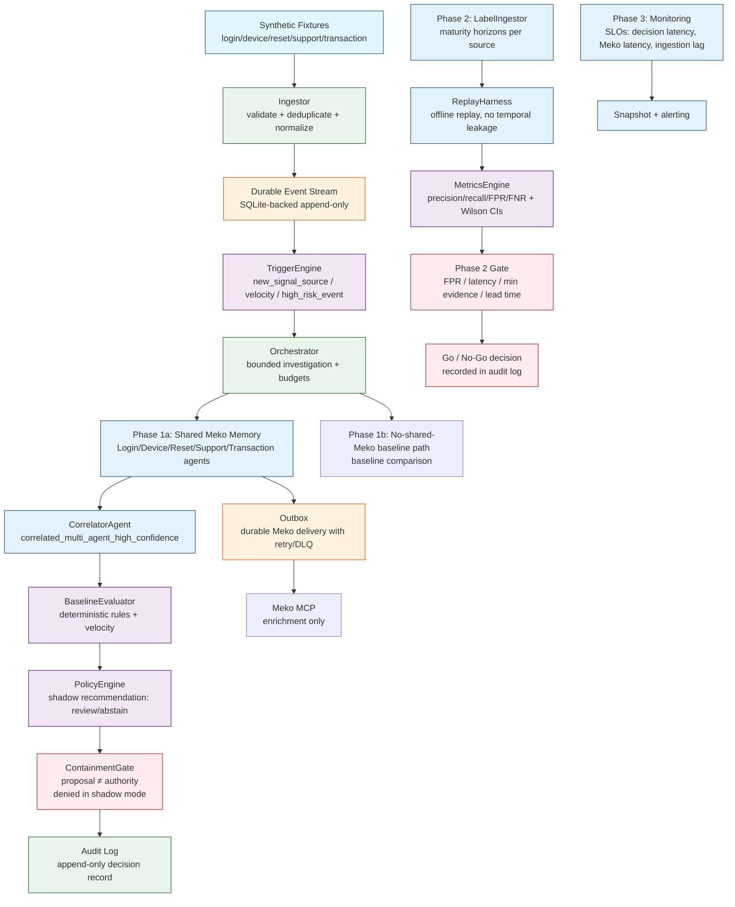

# meko hackthon — Agentic Fraud Detection System

A production-grade, agentic fraud detection system built as a **cross-channel takeover detector** covering **login + support + payment** signals, with an **analyst copilot** that explains every alert.

It detects account-takeover (ATO) patterns across channels:

| Channel | Signals detected |
|---------|------------------|
| Login | Credential stuffing, failed login velocity, new location/IP |
| Device | New device, emulator detected |
| Support | Password reset after failures, unusual timing, multiple resets |
| Payment | New payee, test payments, limit changes, cash-out sequences |

For each alert, the system produces a **shadow recommendation** (non-actionable in shadow mode) with reason codes, evidence provenance, confidence scores, and a plain-language explanation — so human analysts can review and act, not just react to a black-box score.

## End-to-end flow chart



## System overview

```
┌─────────────────────────────────────────────────────────────────────────────┐
│  PHASE 1 — Thin vertical slice (deterministic baseline + shadow mode)       │
│  ingest → trigger → bounded investigation → scoped agents → correlator →   │
│  Meko write/search → deterministic baseline → policy → shadow recommendation│
│  → audit log → containment gate (denied in shadow mode)                     │
├─────────────────────────────────────────────────────────────────────────────┤
│  PHASE 2 — Evaluation and label pipeline                                    │
│  LabelIngestor (maturity horizons) → ReplayHarness (no temporal leakage) →  │
│  MetricsEngine (Wilson CIs) → Phase 2 pilot gate → go/no-go decision        │
├─────────────────────────────────────────────────────────────────────────────┤
│  PHASE 3 — Durable ingestion and shadow operations                          │
│  SQLite storage → durable event stream → outbox pattern → restart recovery  │
│  → monitoring/SLOs → outbox retry/dead-letter                               │
└─────────────────────────────────────────────────────────────────────────────┘
```

## Key design principles

- **Deterministic supervisor** owns investigation state, budgets, deadlines — not an LLM
- **Agent output is evidence, never authority** — the policy engine decides
- **Meko is enrichment only** — memory writes and context searches never execute containment
- **Proposal ≠ authority** — the containment gate denies all proposals in shadow mode
- **Append-only audit log** is the authoritative record; Meko traces are supplementary
- **No temporal leakage** — replay uses only features available at decision time
- **Idempotent ingestion** — duplicate events by `idempotency_key` are rejected
- **Durable persistence** — SQLite storage survives process restarts; investigations recover on restart

## Phase-by-phase breakdown

### Phase 1 — Thin vertical slice and deterministic baseline

- Synthetic fixtures for login, device, reset, support, transaction events
- `Ingestor` validates, normalizes, and deduplicates by idempotency key
- `TriggerEngine` fires on `new_signal_source`, `velocity_window_crossing`, or `high_risk_event` (versioned rules)
- `Orchestrator` creates bounded investigations with tool/Meko/token budgets and wall-clock deadlines
- Six scoped agents (login, device, reset, support, transaction, correlator) write typed findings
- `MekoAdapter` writes signals to memory and searches context (enrichment only)
- `BaselineEvaluator` computes deterministic rules-and-velocity scores
- `PolicyEngine` emits shadow recommendations (`review` or `abstain` only — never block/allow)
- `ContainmentGate` enforces `proposal ≠ authority` (denied in shadow mode)
- ≥3 trace walkthroughs written to `trace_walkthroughs.json`
- Baseline comparison: shared Meko memory vs no-shared-Meko path

### Phase 2 — Evaluation and label pipeline

- `LabelIngestor` ingests labels with per-source maturity horizons (chargeback 7d, dispute 3d, analyst_disposition 1h, confirmed_non_fraud 7d)
- Immature labels excluded from mature-negative counts
- `ReplayHarness` performs offline replay comparing agentic vs baseline on point-in-time evidence
- Temporal leakage prevention: input snapshots pinned, fresh runs tracked separately
- `MetricsEngine` computes precision/recall/FPR/FNR with Wilson score CIs, cost, latency, cohort, and baseline-relative lift
- `evaluate_phase2_gates()` checks pilot gates: FPR ≤ 0.5%, p95 latency ≤ 1s, minimum evidence (1000 legit / 100 fraud), median lead time ≥ 5 min
- Gate result recorded to audit log as `phase2_gate_result`

### Phase 3 — Durable ingestion and shadow operations

- `Storage` — SQLite-backed durable persistence for events, investigations, findings, labels, recommendations, audit entries, outbox, dead letters
- `EventStream` — durable append-only stream with subscribe/dispatch, replay from offset, dead-letter queue
- `Outbox` — reliable Meko enrichment delivery with retry, backoff, and dead-letter on max attempts
- `Orchestrator.recover()` — restores open investigations from storage after restart
- `Monitor` — SLO collection: decision latency p95 ≤ 1s, Meko latency p95 ≤ 5s, ingestion lag, alert volume, label coverage
- All state survives process restarts; Meko is not a single point of failure

## Package structure

```
src/fraud_detection/
    domain.py          # event, label, case, evidence, decision models
    ingestion.py       # validation, normalization, idempotency
    orchestration.py   # deterministic supervisor: triggers, state machine, budgets, recovery
    agents/            # scoped agents: login, device, reset, transaction, correlator
    baseline.py        # deterministic rules and velocity features
    policy.py          # versioned decisions, thresholds, abstention
    meko_adapter.py    # MCP transport and tool contracts (enrichment only)
    audit.py           # append-only decision record interface
    containment.py     # proposal validation — proposal is not authority
    settings.py        # validated configuration and secret loading
    cli.py             # local fixture/replay entry point (Phases 1+2+3)
    storage.py         # SQLite durable storage (Phase 3)
    stream.py          # durable event stream with replay/DLQ (Phase 3)
    outbox.py          # outbox pattern with retry/dead-letter (Phase 3)
    monitoring.py      # SLO collection and snapshot (Phase 3)
    labeling.py        # LabelIngestor with maturity horizons (Phase 2)
    replay.py          # ReplayHarness for offline replay (Phase 2)
    metrics.py         # MetricsEngine with Wilson CIs and gate eval (Phase 2)
    triggers.py        # TriggerEngine with versioned rules (Phase 2)
tests/
    unit/              # test_labeling, test_metrics, test_replay, test_triggers
    contract/          # test_label_contracts
    phase3/            # test_phase3 (storage, stream, outbox, orchestrator, monitoring)
```

## Setup

```powershell
# Activate the virtual environment
.\.venv\Scripts\Activate.ps1

# Install the project
python -m pip install -e .

# Copy .env.example to .env and fill in your Meko API key and datapack ID
```

## Run

### Phase 1 end-to-end synthetic flow (shadow mode — no action executed)

```powershell
python main.py
```

Or via the installed script:

```powershell
fraud-detection
```

### Phase 3 with durable storage

```powershell
# Specify a custom database path
python main.py --db=fraud_detection.db

# Disable shadow mode (configuration change — requires credentials configured)
python main.py --no-shadow --db=fraud_detection.db
```

## Output example

```
=== Phase 1 Fraud Detection (shadow_mode=True) ===

[phase3] durable storage=fraud_detection.db, recovered=0 open investigation(s)
[ingest] login for acct_1042: ACCEPTED
[ingest] device for acct_1042: ACCEPTED
[ingest] reset for acct_1042: ACCEPTED
[ingest] support for acct_1042: ACCEPTED
[ingest] transaction for acct_1042: ACCEPTED
[trigger] login triggered new_signal_source: new signal source 'synthetic_login_agent' for account acct_1042

[investigate] created b36ccf44-6c74-4ef0-bd38-84d5fd995d80 (trigger=new_signal_source, budget=10 tool calls, 5 Meko retrievals)

--- Phase 1a: Shared Meko memory path ---
[agent] login_agent: credential_stuffing_detected (confidence=0.8)
[agent] device_agent: suspicious_device (confidence=0.85)
[agent] reset_agent: reset_after_failures_unusual_time (confidence=0.75)
[agent] support_agent: support_takeover_pattern (confidence=0.75)
[agent] transaction_agent: routine_transaction (confidence=0.1)
[budget] Meko retrieval budget exhausted after transaction_agent
[correlator] correlated_multi_agent_high_confidence (confidence=0.95)
[meko] wrote 5 signal(s) to memory
[meko] context search match_quality=mid

--- Phase 1b: No-shared-Meko baseline path ---
[no-meko] findings=5, correlated=correlated_multi_agent_high_confidence (confidence=0.95)
[baseline shared] triggered=False score=0.00 reason_codes=[]
[baseline no-meko] triggered=False score=0.00 reason_codes=[]

[policy shared] recommendation=review uncertainty=high
[policy no-meko] recommendation=review uncertainty=high

[containment] decision=denied_shadow_mode executed=False
  reason: shadow_mode is enabled; containment proposals are logged only and never executed

=== Trace Walkthroughs ===
[trace 1] login -> agent=credential_stuffing_detected -> baseline=False -> policy=review -> containment=denied_shadow_mode
[trace 2] device -> agent=suspicious_device -> baseline=False -> policy=review -> containment=denied_shadow_mode
[trace 3] reset -> agent=reset_after_failures_unusual_time -> baseline=False -> policy=review -> containment=denied_shadow_mode

=== Phase 2: Evaluation and Label Pipeline ===
[labels] ingested=5, mature=5, immature=0
[replay] login baseline=False agentic=abstain latency=0.4ms
[replay] transaction baseline=True agentic=review latency=0.2ms
[gate] Phase 2 pilot gates: all_pass=False
  minimum_evaluation_evidence: pass=False (5 mature labels vs required 1000/100)
[Phase 2] GATE NOT PASSED — remains in shadow mode, baseline continues

=== Phase 3: Durable Operations Summary ===
  Events persisted:         5
  Outbox delivered:         5
  Outbox failed:            0
  Open investigations:      4
  Database:                 fraud_detection.db
```

## Phase 1 constraints

- Synthetic or approved de-identified signals only — no production signals
- Shadow mode: recommendations are non-actionable (review/abstain only)
- No containment/action credentials or executable action path exists
- Meko integration credentials permitted for hosted memory writes/searches only

## Analyst copilot

Each alert includes:
- Reason codes (e.g., `new_payee`, `test_payment`, `failed_login_velocity`)
- Evidence provenance (which agent/source contributed what)
- Confidence scores per finding
- Baseline score and trigger rationale
- Policy and model versions for audit traceability

This gives analysts a clear, explainable narrative for every alert rather than an opaque score.

## Audit log

The append-only `audit.log` is the authoritative decision record. Entry types include:

| Type | Description |
|------|-------------|
| `event` | Incoming synthetic event |
| `ingestion_result` | Accepted/duplicate/rejected |
| `investigation_created` | Investigation opened |
| `finding` | Agent finding |
| `recommendation` | Shadow recommendation |
| `containment_proposal` | Containment proposal (shadow mode) |
| `containment_review` | Human analyst review decision |
| `containment_execution` | Execution result |
| `phase2_gate_result` | Phase 2 gate evaluation |
| `investigation_transition` | State change |

## Running tests

```powershell
# Install test dependencies
python -m pip install pytest

# Run all tests
python -m pytest tests/ -v

# Run Phase 3 tests specifically
python -m pytest tests/phase3/ -v
```

## Data persistence

Events, investigations, findings, labels, recommendations, audit entries, outbox messages, and dead letters are persisted to `fraud_detection.db` (SQLite, WAL mode). The database path is configurable via `--db=`.

On restart, `Orchestrator.recover()` reloads open investigations from storage so work resumes safely.
